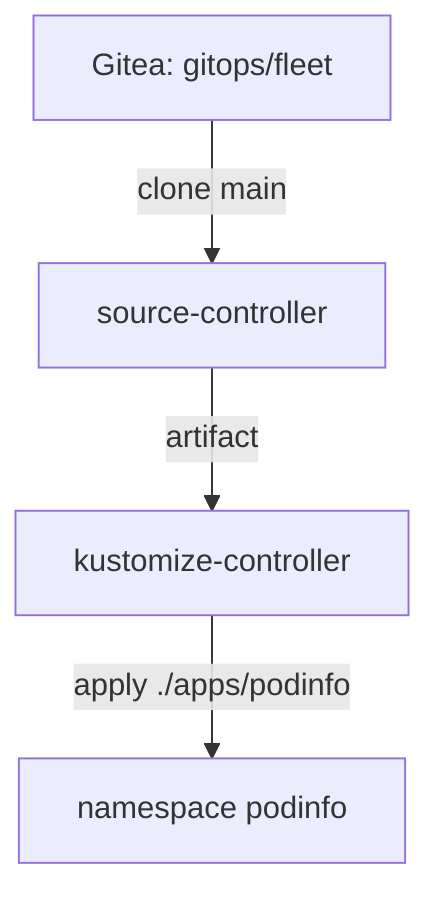

# Your First GitRepository And Kustomization

The Flux controllers in your playground are running, but they have nothing to do: no object tells them where the desired state is. This part creates the two objects that start the loop. A `GitRepository` makes source-controller fetch the repository, and a Flux `Kustomization` makes kustomize-controller apply one folder of it. Then you change the application the GitOps way, with a commit.

## How the two objects work together

The work is split between two controllers, and each one owns one of the objects. source-controller reads a `GitRepository`, clones the branch it names, and stores the files of that commit as an **artifact**: a `tar.gz` file that source-controller serves over HTTP inside the cluster. kustomize-controller reads a Flux `Kustomization`, downloads the artifact of the source it points at, builds the folder given in `path`, and applies the result to the cluster.



The diagram shows the chain: source-controller turns a Git commit into an artifact, and kustomize-controller turns the artifact into objects in the cluster.

The split matters when something fails. If the repository cannot be read, the `GitRepository` is not ready and kustomize-controller has nothing new to apply. If the folder is wrong, the `GitRepository` is fine and the Flux `Kustomization` reports the error. So you always check the source first, then the sync.

## Give Flux read access to the repository

The repository `gitops/fleet` is private, so source-controller needs credentials. Flux reads them from a Kubernetes Secret with the keys `username` and `password`. The `flux` tool creates that Secret for you in the namespace `flux-system`:

<!-- astrona:playground:renew -->

```sh
flux create secret git fleet-auth \
  --url=http://gitea.localtest.me:3000/gitops/fleet.git \
  --username=gitops \
  --password=gitops-password
```

The command creates the Secret `fleet-auth` in `flux-system`. The password is the lab-only Gitea password; on a real Git server you would use a token with read access only, or an SSH deploy key.

## Create the GitRepository

Now tell source-controller where the repository is, which branch to follow, and how often to check it. Save this as `gitrepository-fleet.yaml`:

```yaml
apiVersion: source.toolkit.fluxcd.io/v1
kind: GitRepository
metadata:
  name: fleet
  namespace: flux-system
spec:
  interval: 1m
  url: http://gitea.localtest.me:3000/gitops/fleet.git
  ref:
    branch: main
  secretRef:
    name: fleet-auth
```

Apply it:

```sh
kubectl apply -f gitrepository-fleet.yaml
```

Then check the result:

```sh
flux get sources git
```

The row for `fleet` shows `READY` as `True` and a `REVISION` of the form `main@sha1:` followed by the commit hash. The revision tells you exactly which commit source-controller turned into the current artifact. `interval: 1m` means source-controller checks the branch for a new commit once a minute. Name the branch every time: when `ref` is left out, source-controller follows `master`, and this repository has only `main`.

## Create the Flux Kustomization

The artifact exists, but nothing applies it yet. The Flux `Kustomization` does that. It names the source, the folder inside it, and how often to apply it again. Save this as `kustomization-podinfo.yaml`:

```yaml
apiVersion: kustomize.toolkit.fluxcd.io/v1
kind: Kustomization
metadata:
  name: podinfo
  namespace: flux-system
spec:
  interval: 5m
  path: ./apps/podinfo
  prune: true
  wait: true
  timeout: 2m
  sourceRef:
    kind: GitRepository
    name: fleet
```

Apply it:

```sh
kubectl apply -f kustomization-podinfo.yaml
```

Then check the result:

```sh
flux get kustomizations
kubectl -n podinfo get deployment,service
```

The row for `podinfo` shows `READY` as `True` and the same revision as the source. The namespace `podinfo` now holds the Deployment `podinfo` with 2 ready replicas and the Service `podinfo`. You did not apply any of them: kustomize-controller built `./apps/podinfo` and applied it.

Each field has one job. `path` is the folder inside the artifact. `prune: true` lets Flux delete objects that disappear from that folder later. `wait: true` makes the object become ready only after everything it applied is healthy, so `READY True` means the pods really run. `timeout` is how long that wait may take. `interval: 5m` is how often kustomize-controller applies the folder again, even without a new commit.

## Read what happened

`flux get` shows the current state. To see what happened and in which order, read the events of the object:

```sh
flux events --for Kustomization/podinfo
```

The events show kustomize-controller creating the namespace, the Service and the Deployment, then reporting that the health checks passed and the revision was applied. When something fails, this list says why, in the words of the controller that failed. It is the second command to run after `flux get`.

## Change the application with a commit

Now change the desired state the GitOps way. The port-forward to Gitea must still run in your second terminal. In your clone of the repository, open `apps/podinfo/deployment.yaml` in an editor and change `replicas: 2` to `replicas: 3`. Then commit and push:

```sh
git commit -am "Scale podinfo to 3 replicas"
git push
```

Flux would find the commit within a minute and apply it within five, at the latest. You do not have to wait. Ask Flux to fetch the source and apply it now:

```sh
flux reconcile kustomization podinfo --with-source
kubectl -n podinfo get deployment podinfo
```

`--with-source` makes the `flux` tool ask source-controller to fetch the repository first, then kustomize-controller to apply the new artifact. The Deployment now shows 3 replicas, and `flux get kustomizations` shows the revision of your new commit. `flux reconcile` does not change anything itself; it only asks the controllers to run their normal loop now.

You now have the whole loop running: a commit becomes an artifact, and the artifact becomes objects in the cluster. You can read the state with `flux get` and the history with `flux events`. The open question is what Flux does when the cluster changes without a commit, which is what drift correction is about.

## Common pitfalls

> [!WARNING]
> - **Leaving out the branch.** Without `ref`, source-controller follows `master`. On a repository with only `main`, the `GitRepository` never becomes ready.
> - **A path that does not exist.** `path` is relative to the root of the repository. A typo makes the Flux `Kustomization` fail to build, while the `GitRepository` stays `Ready`, so check the sync and not only the source.
> - **Applying the application yourself to "help".** A `kubectl apply` of the files in `apps/podinfo` makes the cluster look right while the Flux `Kustomization` is still broken. Fix the Flux object instead.
> - **Pushing and expecting an instant change.** Flux works on intervals. Use `flux reconcile kustomization <name> --with-source` when you want it now.

## Your mission: Make Flux Apply The Application From Git

You can now point Flux at a repository, apply one folder of it, and read why a source or a sync is not ready. The graded lab gives you a cluster where a `GitRepository` and a Flux `Kustomization` already exist, but `podinfo` never appears, and asks you to fix the two objects so that Flux deploys it from Git.

The lab runs in its own cluster, so first pause your playground. Nothing in it is lost:

```sh
astrona stop ats-094-playground-010-01
```

Then start the lab:

```sh
astrona run --git ssh://git@github.com/astrona-io/ATS094.git -c sections/section-010/module-01/labs/lab-01
```

The task is on the next page. Solve it on your own first. When you think you are done, send it for grading:

```sh
astrona submit -c sections/section-010/module-01/labs/lab-01
```

When the lab is done, remove it and start your playground again:

```sh
astrona destroy ats-094-lab-010-01
astrona start ats-094-playground-010-01
```
