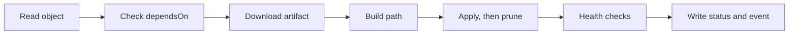

# The Reconcile Cycle And Status Conditions

When you apply a Flux object, nothing happens at that moment. The API server stores the object, and the controller that owns its kind notices the change and does its work later. This part follows one run of that work in kustomize-controller, and then shows where the result appears, so you can read it correctly the next time an object is not `Ready`.

The commands below need a working source and one sync. Create them first: the credentials Secret, the `GitRepository` and a Flux `Kustomization` for the infrastructure folder:

<!-- astrona:playground:renew -->

```sh
flux create secret git fleet-auth \
  --url=http://gitea.localtest.me:3000/gitops/fleet.git \
  --username=gitops --password=gitops-password
flux create source git fleet \
  --url=http://gitea.localtest.me:3000/gitops/fleet.git \
  --branch=main --secret-ref=fleet-auth --interval=1m
flux create kustomization infra \
  --source=GitRepository/fleet --path=./infrastructure \
  --prune=true --interval=5m
```

The three commands create a Secret, a `GitRepository` named `fleet` and a Flux `Kustomization` named `infra` in the namespace `flux-system`. `flux create` writes the same YAML you would write by hand, and applies it.

## What one run does

A reconciliation is one pass of the controller over one object. kustomize-controller does these steps for a Flux `Kustomization`, in this order:

1. It reads the object and checks that it is not suspended.
2. It checks `dependsOn`: every listed object must be `Ready`.
3. It reads the `GitRepository` named in `sourceRef` and downloads the artifact of its current revision.
4. It builds the folder in `path` with Kustomize, and replaces variables if `postBuild` is set.
5. It applies the result to the cluster with server-side apply.
6. It deletes objects that left Git, if `prune` is `true`.
7. It waits for the applied objects to be healthy, if `wait` or `healthChecks` is set.
8. It writes the result into `.status` and emits an event.



The diagram shows the order. A failure at any step stops the run at that step, and the status says which one. That is why the message of an object that is not ready often names a step: a missing dependency, a failed build, an apply error, or a failed health check.

## Read the status of an object

Print the whole status of the object you created:

```sh
kubectl -n flux-system get kustomization infra -o yaml
```

Under `status` you find three kinds of fields. The first kind is the **conditions**, a list of entries with a `type`, a `status` of `True`, `False` or `Unknown`, a `reason` and a `message`. The second kind says which revision the controller used. The third kind is `inventory`, the list of objects the controller applied.

## The three conditions

Flux uses a small set of condition types on all objects.

- `Ready` is the summary. `True` means the last run succeeded and the objects are healthy. `False` means the last run failed or is not finished.
- `Reconciling` is `True` while the controller is working on a change or retrying. It is `True` for a short time after every new commit, and it stays `True` while a health check waits.
- `Stalled` is `True` when the controller decided that running again will not help until someone changes the object or its inputs, for example when the spec is invalid. A stalled object is not retried by the same input.

Read the `Ready` condition on its own:

```sh
kubectl -n flux-system get kustomization infra \
  -o jsonpath='{.status.conditions[?(@.type=="Ready")]}{"\n"}'
```

The `reason` is a short word such as `ReconciliationSucceeded`, and the `message` holds the detail, for example the revision that was applied. `flux get kustomizations` shows the same message in its last column.

## Generation and observedGeneration

Kubernetes increases `.metadata.generation` every time the `spec` of an object changes. A controller copies the generation it worked on into `.status.observedGeneration`. If the two numbers differ, the status describes an older spec, and its `Ready` value is not about your latest edit.

```sh
kubectl -n flux-system get kustomization infra \
  -o jsonpath='generation={.metadata.generation} observed={.status.observedGeneration}{"\n"}'
```

The numbers are equal after a finished run. Right after you edit the spec, they differ until the controller has handled the change. When you script a check, compare both numbers before you trust `Ready`.

## Revisions: attempted and applied

Two status fields tell you where a failure is. `lastAttemptedRevision` is the revision the controller tried to apply in its latest run. `lastAppliedRevision` is the last revision that was applied and healthy.

```sh
kubectl -n flux-system get kustomization infra \
  -o jsonpath='attempted={.status.lastAttemptedRevision}{"\n"}applied={.status.lastAppliedRevision}{"\n"}'
```

On a healthy object they are the same. When a new commit breaks the build, the attempted revision moves to the new commit and the applied revision stays on the old one. The cluster keeps running the old, working state, and the difference between the two fields is the sign that the newest commit did not work.

## Events

Conditions show the last result. Events show the history. Kubernetes keeps them for a short time, and `flux events` reads them for you:

```sh
flux events --for Kustomization/infra
```

Each event has a type (`Normal` or `Warning`), a reason and a message. Use the order: `flux get` for the state, `kubectl get -o yaml` for the exact fields, `flux events` for what happened.

You now know what one run does and where it writes the result. The open question is time: when does the next run start, and how long does the controller wait before it tries again after a failure?

## Common pitfalls

> [!WARNING]
> - **Reading `Ready` without the generation.** After an edit, the old `Ready True` stays until the controller has run. Compare `observedGeneration` with `generation`.
> - **Treating `Reconciling` as an error.** `Reconciling` is `True` during normal work. Worry only when it stays `True` together with `Ready False` for a long time.
> - **Reading only the last event.** The last event can be a normal retry message. Read the `Ready` message first.
> - **Assuming a stalled object retries.** A `Stalled` object waits for a change of the spec or of its source. Fix the input, then reconcile.
