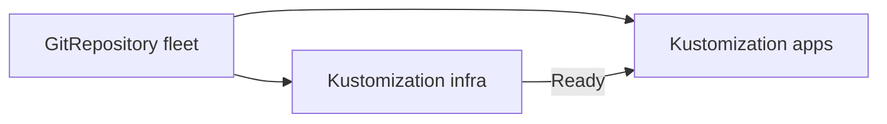

# Dependencies And Ordering

Some objects must exist before others can work. An application needs its namespace, its custom resource definitions (CRDs) and its database before it starts. kustomize-controller applies every Flux `Kustomization` on its own schedule, so without a rule it can apply the application before the platform is ready. The field `dependsOn` is that rule.

The commands below need the `GitRepository` `fleet` and the Flux `Kustomization` `infra` (path `./infrastructure`), both `Ready`, with a health check on the Deployment `cache` in the namespace `platform`. If your playground lacks them, create them with `flux create source git` and `flux create kustomization`:

<!-- astrona:playground:renew -->

## Why order matters

Inside one Flux `Kustomization`, Kustomize already applies Namespaces and CRDs first, and kustomize-controller applies the rest in a fixed order of kinds. Between two Flux `Kustomization` objects there is no order. They run at the same time, each on its own interval. If `apps` needs something that `infra` creates, `apps` can run first and fail, and it only works after its next retry.

## dependsOn

Add a second Flux `Kustomization` for the application that names `infra` as a dependency. Save this as `kustomization-apps.yaml`:

```yaml
apiVersion: kustomize.toolkit.fluxcd.io/v1
kind: Kustomization
metadata:
  name: apps
  namespace: flux-system
spec:
  interval: 5m
  retryInterval: 30s
  path: ./apps/podinfo
  prune: true
  wait: true
  timeout: 2m
  dependsOn:
    - name: infra
  sourceRef:
    kind: GitRepository
    name: fleet
```

Apply it and look at the result:

```sh
kubectl apply -f kustomization-apps.yaml
flux get kustomizations
```

`apps` becomes `Ready` after `infra`. Each entry in `dependsOn` names a Flux `Kustomization` (or a `HelmRelease`) by `name`. When the dependency is in another namespace, add `namespace`. The list can have several entries, and `apps` runs only when all of them are ready.



Both objects read the same source. The arrow from `infra` to `apps` shows the condition: kustomize-controller starts a run of `apps` only after `infra` is `Ready`.

## What a dependency means exactly

A dependency is ready when its `Ready` condition is `True` and its `observedGeneration` equals its `generation`. The check happens at the start of every run of `apps`, not only the first. If `infra` becomes unhealthy later, for example after a bad commit, `apps` does not run until `infra` is ready again. The objects that `apps` applied earlier stay as they are. Only new runs wait.

A missing dependency is a different case. Create a typo on purpose to read the message:

```sh
kubectl -n flux-system patch kustomization apps --type=merge -p '{"spec":{"dependsOn":[{"name":"infrastructure"}]}}'
flux get kustomizations
kubectl -n flux-system get kustomization apps \
  -o jsonpath='{.status.conditions[?(@.type=="Ready")].message}{"\n"}'
```

`apps` is not `Ready`. Its message names the dependency `flux-system/infrastructure` and says it was not found. kustomize-controller stops at the second step of the run, so it never downloads the artifact or builds the folder. Restore the right name:

```sh
kubectl -n flux-system patch kustomization apps --type=merge -p '{"spec":{"dependsOn":[{"name":"infra"}]}}'
flux reconcile kustomization apps
```

## Dependencies and health checks work together

`dependsOn` only looks at `Ready`. If `infra` has no `wait` and no `healthChecks`, it is `Ready` as soon as the apply call works, before the pods run. Then `apps` starts too early, and the order has no value. That is why the pair matters: a health check makes `infra` ready only when the cache really runs, and `dependsOn` makes `apps` wait for that.

Check the order in your playground. Suspend `infra`, scale the Deployment `cache` to zero replicas, and resume:

```sh
flux suspend kustomization infra
kubectl -n platform scale deployment cache --replicas=0
flux resume kustomization infra
flux get kustomizations
```

`infra` applies the folder again, which sets the replicas back to 1 and waits until the Deployment is available. While it waits, `apps` shows that it is waiting for its dependency. This is the normal startup order for a whole cluster, written as objects.

## Cycles and cross-namespace limits

Two objects that depend on each other can never become ready. The controller reports a dependency cycle for that case. Keep the graph a tree: a platform layer, then add-ons, then applications. Administrators can also stop cross-namespace references with the flag `--no-cross-namespace-refs`, so that a tenant cannot depend on objects in another namespace.

## Common pitfalls

> [!WARNING]
> - **Typing the wrong name.** `dependsOn` takes the name of a Flux object, not the name of a folder or of a Deployment.
> - **A dependency with no health check.** The dependency is ready when the apply succeeds, so the order does not wait for pods.
> - **Expecting a rollback.** When a dependency fails later, the dependent object keeps what it applied. It only stops running again.
> - **Circular dependencies.** `a` depends on `b` and `b` on `a` means neither runs.

## Your mission: Fix The Apps Kustomization That Waits Forever

You can now read a failed health check, write `dependsOn`, and find why a dependent object does not start. The graded lab gives you two Flux `Kustomization` objects, `infra` and `apps`, that were written by a colleague and that never both become ready. Find both mistakes and fix them without removing the health check or the dependency.

The lab runs in its own cluster, so first pause your playground. Nothing in it is lost:

```sh
astrona stop ats-094-playground-010-02
```

Then start the lab:

```sh
astrona run --git ssh://git@github.com/astrona-io/ATS094.git -c sections/section-010/module-02/labs/lab-01
```

The task is on the next page. Solve it on your own first. When you think you are done, send it for grading:

```sh
astrona submit -c sections/section-010/module-02/labs/lab-01
```

When the lab is done, remove it and start your playground again:

```sh
astrona destroy ats-094-lab-010-02
astrona start ats-094-playground-010-02
```
