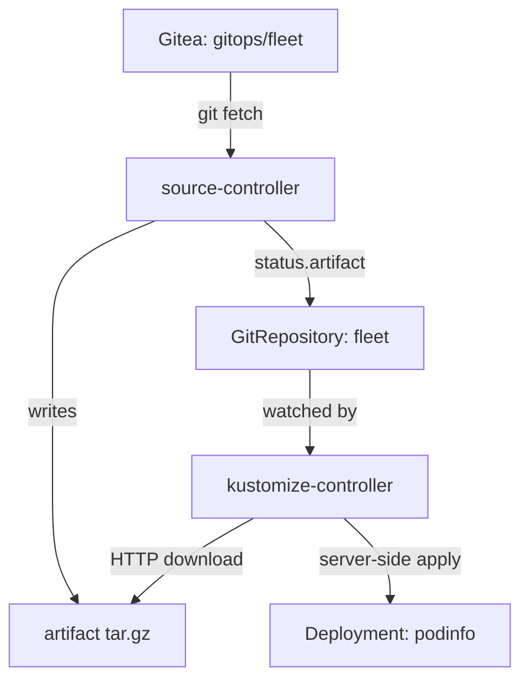

# The Controllers And The APIs They Own

When a Flux object does not become ready, you need to know which program was supposed to make it ready. Flux splits its work across several controllers, and each one owns a small set of custom resource kinds. This part lists them, shows where they live in your cluster, and follows one Git revision from the controller that fetches it to the controller that applies it.

## The controllers in your cluster

Start with what is running. `flux install` put every Flux controller in the namespace `flux-system`, each as its own Deployment. List them:

<!-- astrona:playground:renew -->

```sh
kubectl -n flux-system get deployments
```

You see four Deployments, each with one ready replica: `source-controller`, `kustomize-controller`, `helm-controller` and `notification-controller`. These are the four controllers Flux installs by default. Each one is a separate program with its own pod, its own logs and its own permissions, so one of them can fail while the others keep working.

Each controller watches custom resources of a few kinds. A custom resource is an object of a kind that Kubernetes does not know by itself; a **CustomResourceDefinition (CRD)** adds that kind to the Kubernetes API, with a schema for its fields. Flux groups its kinds into API groups that all end in `toolkit.fluxcd.io`, and every API group belongs to one controller:

| Controller | API group | Kinds |
| --- | --- | --- |
| source-controller | `source.toolkit.fluxcd.io/v1` | `GitRepository`, `OCIRepository`, `HelmRepository`, `HelmChart`, `Bucket`, `ExternalArtifact`, `ArtifactGenerator` |
| kustomize-controller | `kustomize.toolkit.fluxcd.io/v1` | `Kustomization` |
| helm-controller | `helm.toolkit.fluxcd.io/v2` | `HelmRelease` |
| notification-controller | `notification.toolkit.fluxcd.io` | `Provider`, `Alert`, `Receiver` |
| image-reflector-controller (optional) | `image.toolkit.fluxcd.io/v1` | `ImageRepository`, `ImagePolicy` |
| image-automation-controller (optional) | `image.toolkit.fluxcd.io/v1` | `ImageUpdateAutomation` |

The table says who to blame. A `GitRepository` that never gets a new revision is a source-controller question. A Flux `Kustomization` that has the revision but does not apply it is a kustomize-controller question. The two image controllers are not installed in your playground; adding them is a later subject.

## The CRDs that make the kinds exist

The controllers can only watch kinds that the API server knows. You can see the CRDs Flux installed by filtering on the API group suffix:

```sh
kubectl get crds | grep toolkit.fluxcd.io
```

Each line is one kind, written as the plural name plus the API group, for example `gitrepositories.source.toolkit.fluxcd.io` and `kustomizations.kustomize.toolkit.fluxcd.io`. There is no CRD for the image kinds, because the image controllers are not installed. The CRD and the controller are two separate things: the CRD lets you store an object, and the controller does something with it.

The API server can also tell you the kinds of one group, with their short names. This is the fastest way to check whether a kind exists at all:

```sh
kubectl api-resources --api-group=source.toolkit.fluxcd.io
```

The output lists one row per source kind, with its short name and the fact that every kind lives in a namespace. The short names work with `kubectl`, so `kubectl -n flux-system get gitrepository` and the short form return the same list.

## One revision, two controllers

The two controllers you see working in the playground never call each other. They hand over work through the `GitRepository` object and a file called an artifact. An **artifact** is a `tar.gz` file of one source revision that source-controller stores and serves over HTTP inside the cluster.



The diagram shows source-controller fetching Git and recording the artifact in the status of the `GitRepository`, and kustomize-controller reading that status, downloading the artifact and applying it to the cluster.

You can read the hand-over yourself. source-controller writes the artifact's details into `status.artifact` of the `GitRepository`. Print that field:

```sh
kubectl -n flux-system get gitrepository fleet -o jsonpath='{.status.artifact}' | jq
```

The JSON has these fields:

| Field | What it holds |
| --- | --- |
| `revision` | The branch and commit, in the form `main@sha1:<commit>` |
| `digest` | A `sha256` digest of the `tar.gz` file, so the consumer can check it downloaded the right file |
| `url` | The in-cluster HTTP address of the file, served by the `source-controller` Service in `flux-system` |
| `path` | Where the file sits in source-controller's storage |
| `size` | The size of the file in bytes |
| `lastUpdateTime` | When source-controller last stored a new artifact |

Now look at the other side of the hand-over. The Flux `Kustomization` `podinfo` records which revision it applied last. Compare it with the artifact's revision:

```sh
kubectl -n flux-system get kustomization podinfo -o jsonpath='{.status.lastAppliedRevision}{"\n"}'
```

When everything is healthy, the two revisions are the same. If the `GitRepository` shows a newer revision than the Flux `Kustomization` has applied, source-controller did its job and the question moves to kustomize-controller. This one comparison often halves a search.

The artifact address only works inside the cluster. Flux also installs network policies by default that let only pods in `flux-system` reach the controllers, so a download from another namespace is refused. That is why you read the artifact through its status, not by downloading it.

## What kustomize-controller does with the artifact

kustomize-controller downloads the artifact, unpacks it, and builds the path the Flux `Kustomization` names, here `./apps/podinfo`. If that path holds a Kustomize file `kustomization.yaml`, kustomize-controller runs a Kustomize build on it; if not, it generates one that lists every YAML file in the path. It then applies the result with server-side apply, waits for the objects to be ready when `wait` is on, and deletes objects that left Git when `prune` is on.

Every object kustomize-controller applies gets two labels that name the Flux `Kustomization` that owns it. Check them on the `podinfo` Deployment:

```sh
kubectl -n podinfo get deployment podinfo --show-labels
```

Among the labels you find `kustomize.toolkit.fluxcd.io/name=podinfo` and `kustomize.toolkit.fluxcd.io/namespace=flux-system`. When you meet an object in a cluster and wonder whether Flux manages it, these two labels answer the question, and they tell you which Flux `Kustomization` to look at.

You now have the map. Each controller is its own Deployment in `flux-system`, each owns the kinds of one API group, and the CRDs are what make those kinds exist. source-controller and kustomize-controller work together only through `status.artifact` and the artifact file. The open question is how the `flux` command-line tool fits in, since you never talked to a controller directly.

## Common pitfalls

> [!WARNING]
> - **Treating Flux as one program.** A failing Flux `Kustomization` with a healthy `GitRepository` is a kustomize-controller problem, not a Git problem. Find the owner of the kind first.
> - **Confusing the CRD with the controller.** A CRD lets the API server store an object; nothing happens to it unless the matching controller runs.
> - **Comparing the wrong revisions.** Compare `status.artifact.revision` on the `GitRepository` with `status.lastAppliedRevision` on the Flux `Kustomization`. If they differ, the source is not the problem.
> - **Mixing up the two `Kustomization`s.** The Flux `Kustomization` object tells kustomize-controller which path to build; the Kustomize file `kustomization.yaml` inside that path lists the files to build.
> - **Downloading an artifact from your own pod.** Flux's default network policies block it. Read the artifact's status instead.
