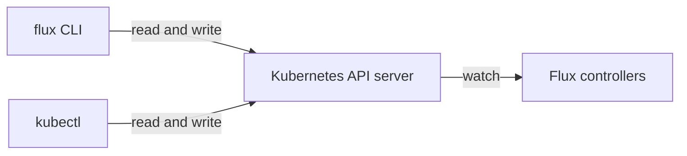

# The Flux CLI Against The Controllers

The `flux` command-line tool feels like the place where Flux runs. It is not. Every Flux feature works without it, and a cluster managed by Flux never needs it. This part shows what each common `flux` command really does to the cluster, so you can read its output with the right expectations and do the same job with `kubectl` when you have to.

## A client of the Kubernetes API

The `flux` command-line tool is a client, like `kubectl`. It uses your kubeconfig, sends requests to the Kubernetes API server, and reads or writes custom resources. It never talks to a controller directly. The controllers in `flux-system` notice the change through the API server and do the work.



The diagram shows that the `flux` command-line tool and `kubectl` reach the same API server, and that the controllers only see what is stored there.

That has two practical results. First, anything `flux` does, you can also do with `kubectl`, and a pipeline can do it with plain YAML. Second, a working `flux` command proves nothing about the controllers: `flux` can write an object while the controller that should act on it is stopped.

## Reading: get, events, logs and tree

Most of the time you use `flux` to read. Four commands cover almost every question, and each one reads a different thing from the API server. Start with the readiness of every Flux object:

<!-- astrona:playground:renew -->

```sh
flux get all --all-namespaces
```

`flux get` reads the custom resources and prints one line per object: its name, the revision it has, whether it is suspended, the `Ready` condition and its message. Here the `GitRepository` `fleet` and the Flux `Kustomization` `podinfo` both show `True`, and both name the same revision `main@sha1:...`. `kubectl -n flux-system get gitrepository,kustomization` shows similar columns, because they come from the same status fields.

When an object is not ready, the next question is what happened to it and when. Kubernetes events answer that. The controllers record an event each time they do something to an object:

```sh
flux events --for Kustomization/podinfo
```

The output lists the recent events for that one object, oldest first, with a reason and a message, for example that a reconciliation finished and which revision it applied. `kubectl -n flux-system events --for kustomization/podinfo` reads the same events. Events expire after about an hour, so an old problem may no longer be there.

Events are short. The controller logs hold the detail, and `flux logs` reads them from the controller pods and keeps only the lines about the objects you ask for:

```sh
flux logs --kind=Kustomization --name=podinfo
```

Each line is a JSON log entry from kustomize-controller about the Flux `Kustomization` `podinfo`: the reconciliation, the revision, and the objects it changed. `flux logs` reads the same pod logs as `kubectl -n flux-system logs deployment/kustomize-controller`, but it filters by kind and name for you. Add `--level=error` to see only errors, or `--follow` to keep reading.

The last reading command answers which cluster objects a Flux `Kustomization` manages. It reads the inventory, the list of objects kustomize-controller applied, which it keeps in the status of the Flux `Kustomization`:

```sh
flux tree kustomization podinfo
```

You see a tree with the Flux `Kustomization` at the top and, under it, the `Namespace`, `Deployment` and `Service` named `podinfo`. Pods and ReplicaSets do not appear, because Kubernetes created them, not Flux. The same list sits in `status.inventory` of the Flux `Kustomization`.

## Writing: export, reconcile, suspend and resume

The `flux create` commands build custom resources from flags. With `--export`, they print the YAML and change nothing, which is how you produce correct Flux YAML without typing it by hand:

```sh
flux create kustomization demo --source=GitRepository/fleet --path=./apps/podinfo --interval=5m --prune=true --export
```

The command prints a complete `kustomize.toolkit.fluxcd.io/v1` `Kustomization` with the fields you gave and nothing else. Nothing is created in the cluster. In a GitOps workflow you save this YAML in Git instead of applying it; without `--export`, `flux create` writes the object straight to the API server.

`flux reconcile` asks a controller to run now instead of waiting for the next interval. It does not run the reconciliation itself. It sets the annotation `reconcile.fluxcd.io/requestedAt` on the object to the current time, and the controller reacts to the changed annotation:

```sh
flux reconcile kustomization podinfo --with-source
```

With `--with-source`, it first annotates the `GitRepository` `fleet` and waits for a new artifact, then annotates the Flux `Kustomization`. The command waits until the controllers report back and prints the revision that was applied. If the controller is not running, the annotation is still written, but nothing happens, and the command gives up after its timeout.

`flux suspend` and `flux resume` stop and restart reconciliation of one object. They change one field, `spec.suspend`. You can do the same with `kubectl`:

```sh
flux suspend kustomization podinfo
kubectl -n flux-system get kustomization podinfo -o jsonpath='{.spec.suspend}{"\n"}'
flux resume kustomization podinfo
```

The middle command prints `true` while the object is suspended. While suspended, kustomize-controller skips the object, so changes in Git and manual changes in the cluster both stay as they are. `flux resume` sets the field back to `false` and runs a reconciliation at once. A suspended object that someone forgot to resume is a common reason why "Flux stopped applying my changes".

You now know what the `flux` command-line tool is: a convenient client that reads status, events and logs, writes custom resources and annotations, and waits for the controllers to answer. The work always happens in the controllers. The open question is which controllers are there to answer, because Flux does not install all of them by default.

## Common pitfalls

> [!WARNING]
> - **Expecting `flux reconcile` to do the work.** It only sets an annotation. If the owning controller is stopped, nothing happens and the command times out.
> - **Running `flux create` without `--export` in a GitOps setup.** The object then exists only in the cluster, not in Git, and nothing records why it is there.
> - **Forgetting a suspended object.** `flux get` shows `SUSPENDED True`. Until someone runs `flux resume`, neither Git nor drift changes it.
> - **Reading only events.** Events are short and expire after about an hour. For the cause, read `flux logs` for that kind and name.
> - **Looking for pods in `flux tree`.** The inventory lists only what Flux applied. Kubernetes creates the pods and ReplicaSets.
