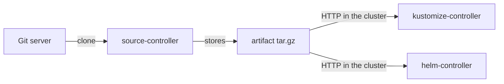

# Artifacts And The Source Status

A Git repository is not something a controller can apply. It has history, branches and a protocol. What the other controllers need is a fixed set of files at one point in time. source-controller makes exactly that: it fetches the repository, takes the files of one commit, and stores them as an artifact. This part shows what an artifact is, where it lives, and how to read its status.

The commands below need a `GitRepository` `fleet` in the namespace `flux-system`. Create it with the credentials Secret first:

<!-- astrona:playground:renew -->

```sh
flux create secret git fleet-auth \
  --url=http://gitea.localtest.me:3000/gitops/fleet.git \
  --username=gitops --password=gitops-password
flux create source git fleet \
  --url=http://gitea.localtest.me:3000/gitops/fleet.git \
  --branch=main --secret-ref=fleet-auth --interval=1m
```

## What an artifact is

An **artifact** is a `tar.gz` archive that holds the files of one revision of a source. source-controller stores it on its own disk and serves it over HTTP inside the cluster. A **revision** is the name of that content: for Git, it is the reference and the commit hash, for example `main@sha1:` followed by 40 hexadecimal characters. A **digest** is a checksum of the archive, with the algorithm in front, for example `sha256:` followed by the hash.



The diagram shows the rule: only source-controller talks to the Git server, and the other controllers download the artifact from source-controller. This is why credentials for Git live on the source, not on the Flux `Kustomization`.

## Read status.artifact

The artifact is described in the status of the source:

```sh
kubectl -n flux-system get gitrepository fleet -o jsonpath='{.status.artifact}{"\n"}'
```

The result has these fields:

| Field | Meaning |
| --- | --- |
| `path` | Where the archive is stored inside the controller |
| `url` | The HTTP address that other controllers use to download it, on the Service `source-controller` |
| `revision` | The reference and commit, for example `main@sha1:...` |
| `digest` | The checksum of the archive |
| `lastUpdateTime` | When source-controller built it |
| `size` | The archive size in bytes |

When two sources show the same `digest`, their content is the same, even if they come from different repositories.

The artifact lives in the file system of the source-controller pod. By default that file system is not persistent. When the pod restarts, source-controller fetches every source again and rebuilds the artifacts, and the other controllers continue with the same revisions. Nothing is lost because Git or the registry is still the source of truth.

## Read the list

For a quick look at all sources, ask for them by kind or all together:

```sh
flux get sources git
flux get sources all
```

The output has one row per object with its `REVISION`, whether it is `SUSPENDED`, whether it is `READY`, and the `MESSAGE` of the `Ready` condition. The `all` form includes `OCIRepository`, `HelmRepository`, `HelmChart` and `Bucket` objects. When a source is not ready, the message names the step that failed: authentication, a missing reference, or a network error.

## Fetching on demand

source-controller checks the remote on the `interval` of the source. For `fleet` that is one minute. Ask it to check now:

```sh
flux reconcile source git fleet
```

The command sets the annotation `reconcile.fluxcd.io/requestedAt` on the `GitRepository`. source-controller sees it, fetches, and builds a new artifact only if the revision changed. If the commit is the same, the digest and `lastUpdateTime` stay as they were. This is a cheap check, and it is the first step of `flux reconcile kustomization --with-source`.

## Stopping a source

A source can be suspended. Use it when you want Flux to stop following new commits, for example during an incident:

```sh
flux suspend source git fleet
flux get sources git
flux resume source git fleet
```

While the source is suspended, source-controller does not fetch, so the artifact stays on the last revision. Flux `Kustomization` objects that use the source keep applying that old artifact on their own interval. Suspending a source freezes the content, while suspending a Flux `Kustomization` stops the applying. They are different tools.

## The timeout

Each fetch has a limit, `spec.timeout`, which is 60 seconds by default. A very large repository or a slow network can exceed it, and the `Ready` message then reports a timeout. Raise the value when needed, but first check whether a shallow clone is enough: source-controller already fetches only the commit it needs for a branch or tag, not the whole history.

You now know what source-controller produces and how to read it. The open question is what it fetches: which reference it follows, and which of the files in the repository end up in the artifact.

## Common pitfalls

> [!WARNING]
> - **Reading the Flux `Kustomization` first.** If the source is not ready, the sync only shows a stale revision. Read the source first.
> - **Expecting the artifact to survive a restart.** It is rebuilt from the remote, so a long outage of the Git server can delay the first fetch after a restart.
> - **Confusing the two suspends.** A suspended source freezes the content; a suspended Flux `Kustomization` stops applying it.
> - **Leaving out `interval`.** The field is required. A source without a sensible interval either checks too often or too rarely.
